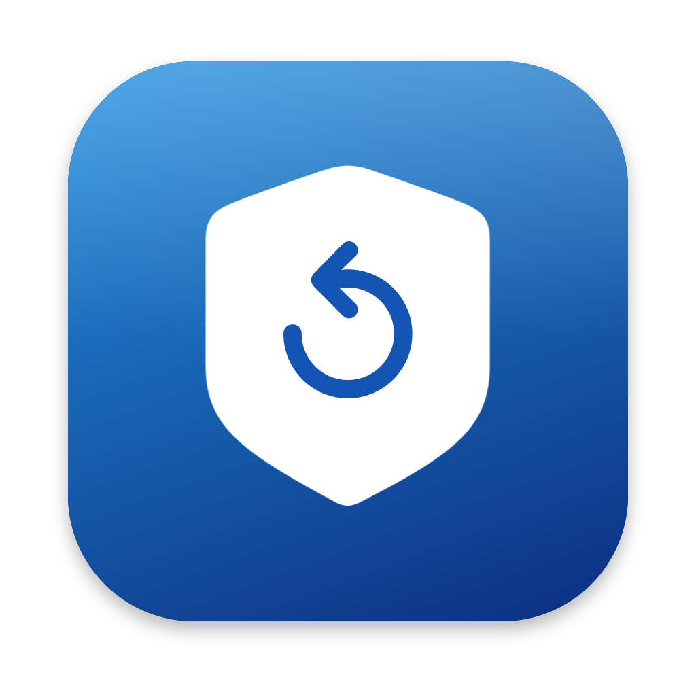
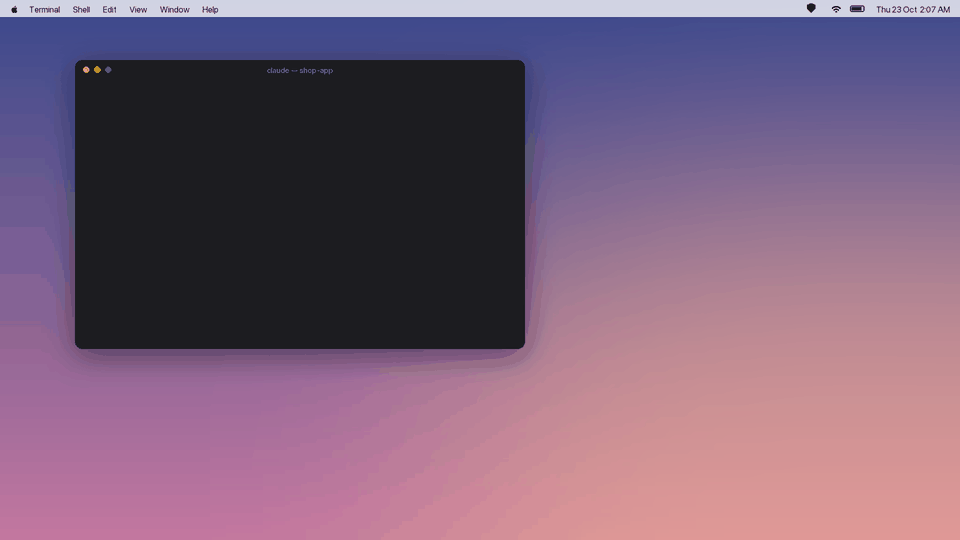
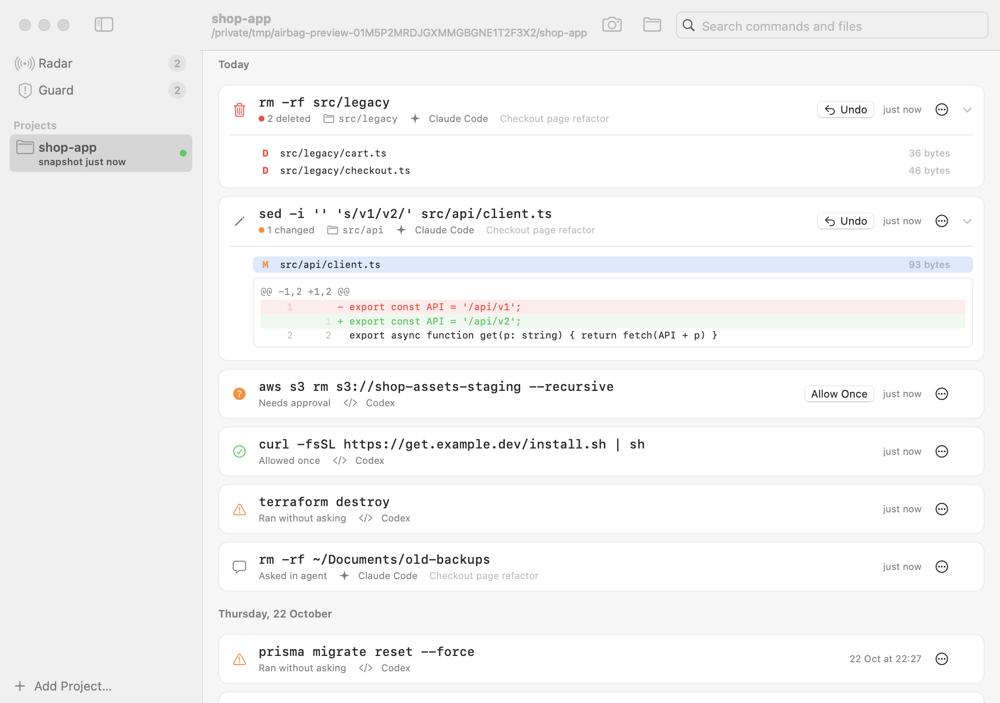
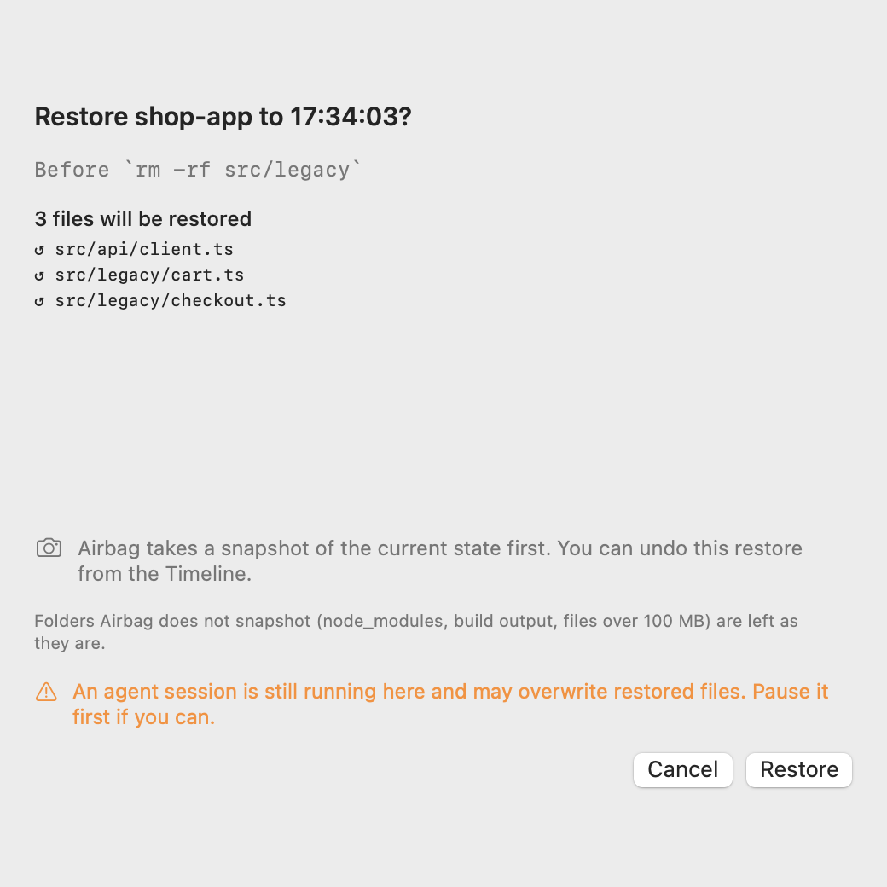
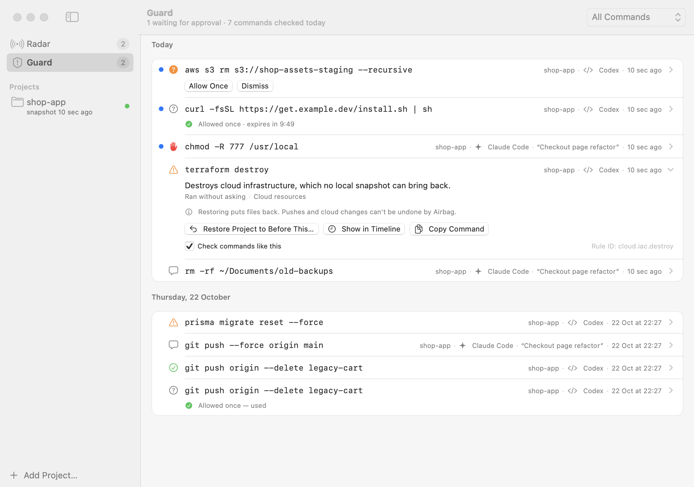
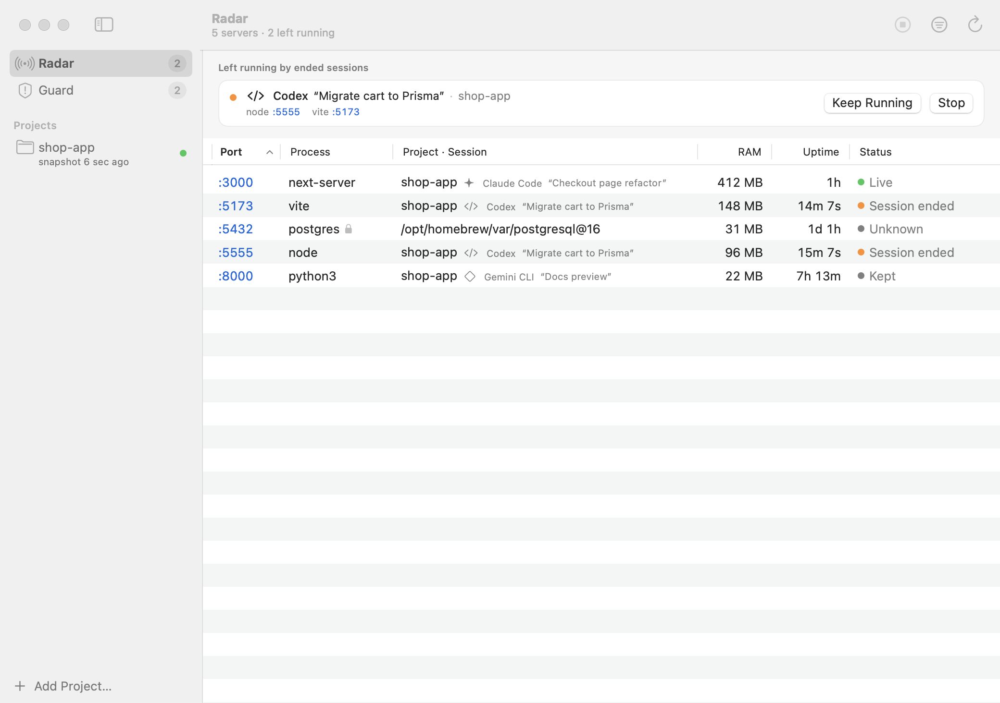
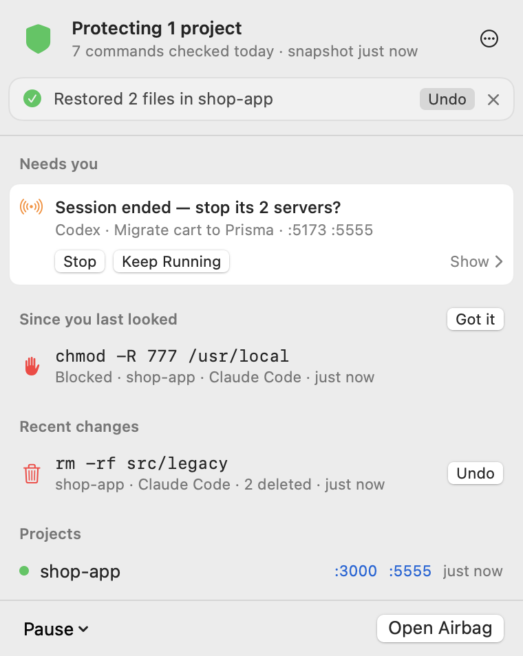
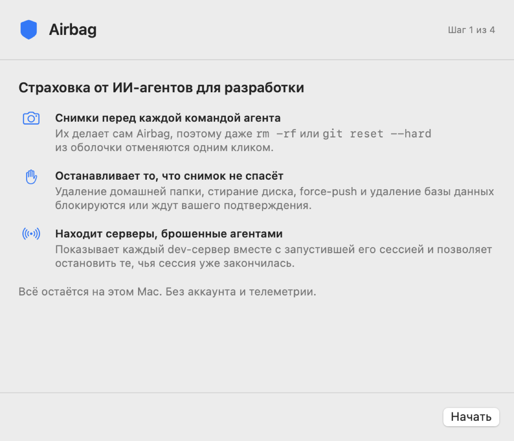

<p align="center">
  
</p>

<h1 align="center">Airbag</h1>

<p align="center">
  <b>Undo what your AI agent just did to your project.</b>
</p>

<p align="center">
  A free Mac menu bar app that snapshots your project before each shell command that can change files,<br>
  whether Claude Code, Codex, Cursor, Gemini CLI or Copilot CLI runs it,<br>
  so a deleted folder, a <code>git reset --hard</code> or a wiped <code>.env</code> is one click back.
</p>

<p align="center">
  <a href="https://github.com/a1murt/airbag/actions/workflows/ci.yml"></a>
  <a href="LICENSE"></a>
  
</p>

<p align="center">
  
</p>

<p align="center">
  <a href="https://github.com/a1murt/airbag/releases/latest"></a>
</p>

| 1. Your agent runs a command | 2. Airbag snapshots first | 3. You click Undo |
|---|---|---|
| `rm -rf src`, `git clean -fdx`, a "cleanup" script | In milliseconds, almost no disk, `.env` included | Right in the menu bar: what that command changed is back |

<p align="center">
  Free &amp; MIT · macOS 14+, Apple silicon and Intel · No account · No telemetry · No network · 19 languages<br>
  <a href="#install">Install</a> · <a href="#how-it-works">How it works</a> · <a href="#faq">FAQ</a> · <a href="docs/ARCHITECTURE.md">Docs</a> · <a href="SECURITY.md">Security</a>
</p>

---

## 2:07 a.m.

You left an agent on a long refactor and went to bed. Somewhere around step forty it decides to start clean:

```console
$ git clean -fdx && git reset --hard
```

Three hours of uncommitted work, gone. Your `.env` too, because git never tracked it. The agent's checkpoints, where it
has them, cover the files it edited itself, not ones only the shell touched, and Time Machine's last local snapshot is
up to an hour old.

**With Airbag, that's one click.** A snapshot landed right before the command ran. Click the shield in the menu bar:
`git clean -fdx && git reset --hard` is at the top of *Recent changes*. Press **Undo**. Your uncommitted work is back,
`.env` included, and the undo itself can be undone.

## Snapshot first, block last

Agents are good enough now that approving every command is the slowest part of the job. So we turn on bypass
permissions or `--yolo`, and hope.

The risk lives in the shell. An agent's own undo, where it has one, stops at the edge of its own edits.
Blocklists help until the command hides inside a script. **A blocklist has to recognise the command. A snapshot
doesn't.**

So Airbag works the other way round. It sits underneath your agents, independent of them, and snapshots the project
before any command that can change files. Blocking is kept for the catastrophic few, like deleting your home folder
or wiping a disk.

I wanted one safety net under every agent I use, whichever one I open that day. That's what an airbag is for: not
to make you drive slower, but to let you drive.

### What each safety net catches

| | **Airbag** | Agent checkpoints | git | Time Machine |
|---|:---:|:---:|:---:|:---:|
| Saves | before each command that can change files | per prompt | when you commit | about hourly |
| Shell commands (`rm`, `mv`, scripts) | ✓ | Claude Code: only files it edited¹ | if committed | last hourly snapshot |
| Uncommitted work | ✓ | own edits only | ✗ | last hourly snapshot |
| `.env` and git-ignored files | ✓² | own edits only | ✗ | last hourly snapshot |
| All your agents, one timeline | ✓ | one agent each | — | — |
| Blocks `rm -rf ~`, disk wipes and the like | ✓ | ✗ | ✗ | ✗ |
| Dev servers agents left running | ✓ Radar | ✗ | ✗ | ✗ |

<sub>¹ Claude Code's <a href="https://code.claude.com/docs/en/checkpointing">checkpointing docs</a>: /rewind undoes Bash
changes only to files Claude had already edited with its own tools; a file that only Bash commands changed isn't tracked.
Cursor's <a href="https://cursor.com/docs/agent/overview#checkpoints">checkpoints</a> capture the files its agent
modified. Time Machine keeps a <a href="https://support.apple.com/en-us/102154">local snapshot about once an hour</a>.
² Except folders named like dependencies, build output or caches, which Airbag skips wherever they are
(<code>node_modules</code>, <code>build</code>, <code>dist</code>, <code>target</code>, <code>.venv</code>,
<code>.cache</code>…), files over 100 MiB (20 MiB on another volume, 1 MiB when the disk is low), and folders that
aren't git repositories once they pass 5,000 files or 500 MB, unless Claude Code, Cursor or Gemini CLI was started in
them.</sub>

## What you get

- **Works in full-auto.** Airbag works in every permission mode, including bypass permissions and `--yolo`.
- **Undo** what the agent just did in one click from the menu bar, `.env` included. A file, a folder or a whole
  deleted project comes back too.
- **See** what each command changed: the timeline lists every command that can change files, with what it deleted,
  changed and added.
- **Block** the catastrophic few, like `rm -rf ~` or wiping a disk, and **flag** other risky commands: force pushes,
  deletes outside the project, dropping a database.
- **Find** the dev server an agent left on `:3000`, and the session that started it.
- **Set it up in under a minute.** One timeline for Claude Code, Codex, Cursor, Gemini CLI and Copilot CLI.

### Timeline: what each command changed

One row per agent command: `rm -rf src/legacy` · 2 deleted · Claude Code, grouped by day. **Undo** puts back what
changed while that command ran. Open a row for its files and diffs, or search a file name to find when it disappeared.

<picture>
  <source media="(prefers-color-scheme: dark)" srcset="docs/images/main-timeline-dark.png">
  
</picture>

### Undo and Restore: both can be undone

**Undo** runs without asking, because it is reversible: Airbag snapshots before it too, and the message offers Undo
again. **Restore** takes a whole project (or one file) back to a chosen moment; it asks first and shows what comes
back, what gets reverted and what is set aside. A restore never deletes, and even a deleted project folder comes back.
What a snapshot doesn't hold, it can't bring back: version-control history (`.git`, `.jj`, `.hg`, `.svn`), files
outside the project, folders named like dependencies, build output or caches, files over 100 MiB (20 MiB for a project
on another volume, 1 MiB when the disk is low), and a folder that isn't a git repository once it passes 5,000 files or
500 MB, unless the agent was started in it.

<p align="center">
  <picture>
    <source media="(prefers-color-scheme: dark)" srcset="docs/images/restore-dark.png">
    
  </picture>
</p>

### Guard: blocks the catastrophic, flags the risky

Deleting your home folder or system folders, wiping a disk, deleting, overwriting or locking a secret no snapshot
holds (an SSH private key or `authorized_keys`, `~/.aws/credentials`, a keychain), deleting Airbag's own data: blocked
before it runs, and the agent is told to ask you instead of retrying. An agent can't approve its own stopped command: `airbag allow`
refuses to run inside an agent's session.

Other risky commands (force push, deleting or overwriting files outside the project, dropping databases, deleting cloud
resources, `curl | sh`, `sudo`) go to the agent's own approval prompt where it has one. Where it has none (Claude Code
with bypass permissions or dontAsk, Codex, Gemini CLI), they run after a snapshot of the project and land in Guard with
a dot on the menu bar icon. To make them wait for you instead, set **When a snapshot can't undo a command** to
**Stop Until I Approve** in Settings, and a notification with **Allow Once** tells you an agent is waiting.

Some always wait for you, whatever that setting says:

- switching Airbag off or deleting its snapshots: shell commands that edit, move or remove an agent's user-level hook
  settings, removing, replacing or locking Airbag's app or its `airbag` command, `airbag hooks uninstall`,
  `airbag prune`, `airbag cleanup`, `brew uninstall` of Airbag;
- a command that needs a snapshot (`rm`, `mv`, `git reset --hard`, `git clean`…) when Airbag couldn't take one;
- a delete that starts at the root of the disk or in your home folder if a variable is empty (`rm -rf "$DIR/"*`,
  `cd "$DIR" && rm -rf *`), a program whose name is only known at run time handed your home or a system folder, and a
  command too long or too deeply nested for Guard to check in time.

While Airbag is paused nothing waits; blocks still apply. Guard reads the command text: it catches an agent's
mistakes, not an agent set on hiding what it runs. Inside the project, the snapshot covers what Guard can't read.

<picture>
  <source media="(prefers-color-scheme: dark)" srcset="docs/images/main-guard-dark.png">
  
</picture>

### Radar: what is on port 3000, and who started it

Every listening dev server with its project, agent and session, even after the agent has exited. Servers left
running by an ended session come first, with **Stop** and **Keep Running** (also right in the notification). Stop
sends SIGTERM; force-stop is a separate click. Click a port to open it.

<picture>
  <source media="(prefers-color-scheme: dark)" srcset="docs/images/main-radar-dark.png">
  
</picture>

### Menu bar: everything at a glance

What just happened, with **Undo**. Anything that needs you. And proof it's working: "212 commands checked today".

<p align="center">
  <picture>
    <source media="(prefers-color-scheme: dark)" srcset="docs/images/popover-dark.png">
    
  </picture>
</p>

## Works with your agents

| Agent | Where |
|---|---|
| **Claude Code** | CLI · desktop · IDE |
| **OpenAI Codex** | CLI · app |
| **Cursor** | IDE · CLI |
| **Gemini CLI** | CLI |
| **GitHub Copilot CLI** | CLI |

Every agent gets a snapshot before each shell command that can change files, the same Guard, and session tracking,
in any permission mode. Protection doesn't depend on the app being open: the hook is a CLI. Codex runs a new hook
only after you trust it once: type `/hooks` in Codex and press `t`.

## How it works

```text
agent ──hook──▶ airbag CLI ──▶ Guard: allow · risky · block
                    │
                    └──▶ snapshot (APFS clones, .env included) ──▶ the command runs

Airbag.app (menu bar): timeline · restore · Guard · Radar · snapshots after file changes
```

- **A hook, not a daemon.** Airbag adds its hook to each agent's *user* settings file, never to your project, keeps
  a backup, and removes exactly its own entries on uninstall.
- **APFS clones.** Unchanged files share storage, so a snapshot takes milliseconds and almost no extra disk (a
  project on another volume gets copies instead). Folders named like dependencies, build output or caches are
  skipped. Read-only commands need no snapshot.
- **The app** adds snapshots after file changes (FSEvents), deletes old snapshots, and shows the timeline, Guard and
  Radar.

### What it doesn't cover

- **Anything outside the project, and remote state.** A delete elsewhere on disk, a force push, a dropped database or
  a deleted cloud resource is flagged, not snapshotted (see Guard above).
- **What Guard can't read.** A script, or interpreter code that computes its paths, gets past checks that stop a
  literal `rm -rf ~`. Inside the project the snapshot still covers it.
- **What snapshots skip:** version-control history, folders named like dependencies or build output, files over
  100 MiB, and projects of more than 400,000 files, whose snapshots never complete.
- **The agent's own edit tools** (Edit, Write): Guard checks shell commands only. The app's snapshots after file
  changes cover those edits while it runs.
- **Other machines.** macOS only, and only agents running on this Mac, not inside a container or VM.

### By the numbers

| | |
|---|---|
| Distinct Claude Code shell commands replayed from the author's Mac | **5,090** |
| Allowed (a snapshot first when they can change files) | **95.9 %** |
| Flagged as risky | **4.0 %** |
| Blocked (twice an agent running `airbag allow` on its own command, once deleting a folder that holds a git project) | **3** |
| Hook time per read-only command, process start to reply, median | **11 ms** |
| Hook time per file-changing command, unchanged 500- to 5k-file project, median | **14–25 ms** |
| First file-changing command in a new 5k-file project, initial snapshot included | **571–591 ms** |
| Snapshot of an unchanged 5k-file project † | **9–11 ms** |
| Snapshot of an unchanged 50k-file project † | **116–184 ms** |
| Restoring 100 files, 5k / 50k-file project † | **60 / 410 ms** |
| Guard test cases, including an adversarial red-team set | **732** |
| Automated tests, run in CI | **161** |

<sub>Apple M4, release build of 0.1.6. Replay 2026-11-11, hook times 2026-11-10; method, scripts and full results in
[benchmarks](docs/BENCHMARKS.md). † From [design/10 §11](docs/design/10-snapshot-engine.md) (2026-10-18), not
re-measured since.<br>
Deep dives: [architecture](docs/ARCHITECTURE.md) · [decisions](docs/DECISIONS.md) ·
[snapshot engine](docs/design/10-snapshot-engine.md) · [Guard rules](docs/design/12-circuit-breaker-rules.md) ·
[dogfooding](docs/research/09-dogfooding.md)</sub>

## Install

```bash
brew install --cask a1murt/airbag/airbag
```

Open Airbag from Applications: the welcome window connects your agents and picks your projects in under a minute.
Homebrew also puts the `airbag` command on your PATH, and `brew upgrade` keeps your agents connected.

Releases are not notarized yet (there is no Apple Developer ID). Each one is built and ad-hoc signed from its tag by
this repository's public [release workflow](.github/workflows/release.yml), which also attaches the build's SHA-256
(`Airbag-<version>.sha256`). The cask checks that SHA-256 and removes the quarantine flag, so macOS doesn't ask on
first launch. To have macOS check the download itself, use the DMG below, or build from source.

<details>
<summary><b>Without Homebrew</b></summary>

**[Download the latest `.dmg`](https://github.com/a1murt/airbag/releases/latest)**, drag Airbag to Applications and
open it. Releases are not notarized yet (there is no Developer ID), so macOS asks once on first launch:
**System Settings → Privacy & Security → Open Anyway** (macOS 15 and later), or right-click Airbag → **Open** (macOS 14).
</details>

### Claude Code plugin

```
/plugin install airbag --marketplace a1murt/airbag
```

On Claude Code older than 2.1.275: `/plugin marketplace add a1murt/airbag`, then `/plugin install airbag@airbag`.
The plugin connects Claude Code to Airbag without Airbag writing hooks into `~/.claude/settings.json` (Claude Code
only records there that the plugin is on) and adds `/airbag:undo`,
`/airbag:changes` and `/airbag:status`. It needs the app (above), which takes the snapshots; until the app is installed
the plugin stays out of the way and says how to get it. If Airbag has also connected Claude Code itself, the plugin's
hooks step aside, so each command is checked once.

<p align="center">
  <picture>
    <source media="(prefers-color-scheme: dark)" srcset="docs/images/welcome-dark.png">
    
  </picture>
</p>

### See it work in 60 seconds

Make a throwaway project with a secret in it:

```bash
mkdir -p ~/airbag-test/src && cd ~/airbag-test
echo "console.log('hi')" > src/app.js && echo "API_KEY=test" > .env
```

1. Menu bar → Airbag → ⋯ → **Add Project…** → `~/airbag-test`.
2. In that folder, ask your agent to run `rm -rf src .env`.
3. Menu bar → Airbag → **Undo** next to `rm -rf src .env`. Both are back, `.env` included.

### Build from source

Xcode Command Line Tools with Swift 6.1 or later are enough (`swift --version`). This builds `build/Airbag.app`:

```bash
git clone https://github.com/a1murt/airbag && cd airbag && make app
```

## Command line

The CLI works without the app. Homebrew links it for you; with the DMG, put it on your PATH with:

```bash
echo 'alias airbag=/Applications/Airbag.app/Contents/Helpers/airbag' >> ~/.zshrc
```

```text
airbag snapshot                        take a snapshot now
airbag snapshots | log                 snapshots, and agent commands with the snapshot before each
airbag changes ID                      files changed by a snapshot
airbag diff FROM [TO] [--path F]       what changed (no TO = working tree)
airbag undo [ID] [--list] [--dry-run]  put back what the newest change did, or a given one; undoable
airbag restore ID [--path P]           restore; never deletes, undoable
airbag usage | cleanup [--dry-run]     disk use per folder; delete the stores of folders that are long gone
airbag prune [--all] [--dry-run]       apply the retention limits now (the app does it hourly)
airbag check "<command>"               what Guard decides, and why (runs nothing)
airbag guard | allow ID                flagged commands; let one waiting command run once (you, not the agent)
airbag ports | stop PID [--force]      dev servers and the session that started them
airbag hooks status                    which agents are connected
airbag hooks install | uninstall --all  or name them: claude-code codex cursor gemini copilot
```

Ask Guard what it would do, without running anything (here from inside a git project):

```console
$ airbag check "rm -rf ~"
BLOCK  snapshot: recommended  (may change files: rm)
  [self.hooks] ask: it removes a folder with an agent's hook configuration, which switches Airbag's protection off.  ← /Users/you
  [fs.rm.catastrophic] block: it would delete your home directory, which no snapshot covers.  ← /Users/you

agent sees: Airbag blocked `rm -rf ~`: it would delete your home directory, which no snapshot covers. Do not retry this command or work around it with another tool; choose a safer, narrower command or ask the user.

$ airbag check "git reset --hard"
ALLOW  snapshot: required  (may change files: git reset)
  [git.reset.hard] allow: it discards uncommitted changes (restorable from the snapshot taken first).  ← git reset --hard
```

## Privacy

No account, no telemetry, no network: the only socket Airbag opens is a local Unix socket between its CLI and its app
([WakeSocket.swift](Sources/AirbagCore/IPC/WakeSocket.swift)).

- Everything stays on your Mac, in `~/Library/Application Support/Airbag`.
- Snapshots are copies of your project, `.env` included, and they never leave the machine.
- Airbag logs the shell commands agents run (token-like secrets masked, output never stored) for the timeline and
  Guard.
- To suggest projects, the welcome window reads the working folder from your recent Claude Code and Codex session
  files, and nothing else from them.
- Airbag touches only its own hook entries in your agents' settings, and keeps a backup.

The threat model is in [SECURITY.md](SECURITY.md).

## FAQ

<details>
<summary><b>Will it slow my agent down or keep interrupting me?</b></summary>

Rarely. The hook takes about 11 ms for a read-only command, which needs no snapshot, and 14–25 ms for one that can
change files in a 500- to 5,000-file project that hasn't changed since the last snapshot (median, process start to
reply); that time grows with the project's size. The first command that can change files in a project Airbag hasn't
snapshotted yet waits for that first snapshot: 571–591 ms for 5,000 files. In a large project (tens of thousands of
files) the first snapshot takes longer than the hook's 1.5 s limit and finishes in the background; until it is done,
commands that need a snapshot (`rm`, `mv`, `git reset --hard`…) wait for you. In a project of more than 400,000 files
(outside the skipped folders) snapshots never complete, so there those commands always wait for you. Replaying 5,090
distinct Claude Code shell commands from the author's Mac, 95.9 % were allowed, 4.0 % were flagged as risky, and 3 were
blocked (twice an agent running `airbag allow` on its own command, once deleting a folder that holds a git project).
</details>

<details>
<summary><b>How much disk do the snapshots use?</b></summary>

Little, and the app keeps it in check. Snapshots are APFS clones, so a file that didn't change takes no extra space
(a project on another volume gets real copies), and files over 100 MiB are skipped (20 MiB on another volume, 1 MiB
when the disk is low). Each project keeps the snapshots of the last 7 days (at most 200), its newest 20 and the ones
you pin; beyond that the oldest go first to keep the total under 5 GB, though a project's newest 20 and pinned
snapshots always stay. Both limits are in Settings → Snapshots. The app applies them hourly; while it is closed
nothing is deleted, and `airbag prune --all` applies the age and count limits by hand. `airbag usage` shows what each
folder takes, and the snapshots of a folder that has been gone for 30 days are deleted (3 days for temporary folders
and agent worktrees).
</details>

<details>
<summary><b>Does it work with bypass permissions and <code>--yolo</code>?</b></summary>

Yes. That's what it's for. Snapshots, blocks and session tracking work in every permission mode, and every snapshot
taken before an agent's command carries its agent and session, so parallel sessions stay apart in one timeline. Where
the agent can't show its own prompt (Claude Code with bypass permissions or dontAsk, Codex, Gemini CLI), a command
Guard flags as risky (a delete outside the project, a force push, `DROP DATABASE`) runs after a snapshot of the project
and is recorded in Guard. To make those wait for you, set **When a snapshot can't undo a command** to
**Stop Until I Approve** in Settings → Agents.
</details>

<details>
<summary><b>My agent already has checkpoints. Why do I need this?</b></summary>

Checkpoints undo the agent's own file edits. Claude Code's docs say /rewind undoes Bash changes only to files it had
already edited, and a file that only Bash commands changed isn't tracked; `rm`, `mv`, `git reset --hard` and cleanup
scripts all run in the shell. Airbag snapshots before every
one of them, for all five agents in one timeline. Use both.
</details>

<details>
<summary><b>I commit often and have Time Machine. Isn't that enough?</b></summary>

git only brings back what you committed. It never saw your uncommitted changes or git-ignored files like `.env`.
Time Machine's local snapshots are hourly, so anything since the last one is gone. Airbag snapshots right before the
command that did the damage.
</details>

<details>
<summary><b>How is this different from a command blocker or a sandbox?</b></summary>

A blocker stops only the commands it recognises, and an agent can phrase a command differently or tuck it inside a
script. Airbag snapshots underneath, so what even a script nobody parsed does inside the project is undoable, and it
blocks only the short list no snapshot can cover. A blocker can run next to it: Claude Code runs every matching hook,
and a deny from any one stops the command. A sandbox limits what an agent can do; Airbag makes what it does in your
project reversible. They stack well.
</details>

<details>
<summary><b>What about databases, cloud resources and force pushes?</b></summary>

They live outside your project's files, so Airbag guards them at the command instead. Force pushes, commands that
drop or wipe a database (`DROP` or `TRUNCATE` through a client, `dropdb`, `mysqladmin drop`, migration resets) and
cloud-resource deletions are flagged as risky and recorded in Guard, or go to the agent's own approval prompt. Set
**When a snapshot can't undo a command** to **Stop Until I Approve** and they wait for you.
</details>

<details>
<summary><b>Can an agent switch Airbag off?</b></summary>

File commands that target Airbag's data (`rm`, `mv`, `cp`, `sed -i`, redirects…) and SQL written into its database are
blocked. Shell commands that edit, move or remove an agent's user-level hook settings (also `plutil`, or inline
`python -c` or `node -e` code that names them), removing, replacing or locking Airbag's app or its `airbag` command,
`airbag hooks uninstall` and `brew uninstall` of Airbag stop the agent until you approve them (in the agent's own prompt, or with **Allow Once** in
Airbag), even where other risky commands are only recorded; so do `airbag prune` and `airbag cleanup`. And agents can't
approve their own commands: `airbag allow` refuses to run inside an agent's session. Guard reads the command text, so it doesn't see an agent's own file-edit
tools, project-level settings (such as `disableAllHooks` in a project's `.claude/settings.json`), or a script, or
interpreter code that builds the file's path at run time, that writes the file; while Airbag is paused only its blocks apply, and a hostile program running as you
can get around all of it.
</details>

<details>
<summary><b>Does the app have to be running?</b></summary>

No. The hook is a CLI, so snapshots before commands and blocks work with the app closed. The app adds snapshots
after file changes, the timeline, Guard and Radar, and it deletes old snapshots: without it, run `airbag prune --all`
now and then.
</details>

<details>
<summary><b>What if Airbag's hook crashes or hangs?</b></summary>

Airbag's hook answers within 4 s: if Guard hasn't decided by then, it refuses the command. If the hook crashes, or the
agent's own timeout comes first, the agent decides. Claude Code, Codex and Cursor run the command anyway; set
**If Airbag doesn't respond in time** to **Block the Command** in Settings → Agents to make Claude Code and Cursor
refuse it (Codex has no such switch). GitHub Copilot CLI refuses a command when the hook errors and runs it when the
hook times out. Because a crash lets a command through in those three, CI feeds 2,000 generated hostile commands to
Guard's parser on every push (`Scripts/guard-fuzz.py`).
</details>

<details>
<summary><b>Linux, Windows, or an agent in a container?</b></summary>

macOS only: snapshots rely on APFS clones (`clonefile`), and the app on FSEvents and macOS process APIs. Guard and the
snapshot before each command run in the agent's hook, so an agent inside a Linux container or VM gets neither; if the
project folder is shared from your Mac and Airbag protects it, the app still snapshots it after file changes.
</details>

<details>
<summary><b>How do I uninstall?</b></summary>

With Homebrew, `brew uninstall --cask airbag` removes Airbag's hooks from every agent too (`--zap` also deletes the
snapshots). Otherwise click **Disconnect** next to each agent in Airbag's Settings (⌘,), or run:

```bash
/Applications/Airbag.app/Contents/Helpers/airbag hooks uninstall --all
```

Then delete the app, and `~/Library/Application Support/Airbag` if you want the snapshots gone too. Airbag removes
exactly its own hook entries and nothing else. If you added the Claude Code plugin, remove it in Claude Code with
`/plugin uninstall airbag@airbag`.
</details>

## Contributing

Pull requests are welcome. The most useful ones:

- **Guard cases.** Found a command Airbag misjudges? Add it to
  [`rules.json`](Tests/AirbagCoreTests/Fixtures/rules.json), or to
  [`rules-redteam.json`](Tests/AirbagCoreTests/Fixtures/rules-redteam.json) for a bypass. Test with `airbag check`,
  never by running the command.
- **Translations.** The app speaks 19 languages; `make l10n` checks every one of them.
- **Bug reports** with the output of `airbag hooks status`.

`make test` runs the Swift Testing suite, `make e2e` runs simulated agents against the real hook binary, `make fuzz`
feeds hostile commands to Guard's parser, and `make app` builds `build/Airbag.app`:

```bash
make test
make e2e
make fuzz
make app
```

See [CONTRIBUTING.md](CONTRIBUTING.md), and report vulnerabilities privately as described in
[SECURITY.md](SECURITY.md).

---

<p align="center">
  <b>If Airbag ever hands you back an afternoon of work, star the repo.</b><br>
  It's how other people running agents find it.
</p>

## License

[MIT](LICENSE). Airbag is an independent project, not affiliated with Anthropic, OpenAI, Anysphere, Google or GitHub.
