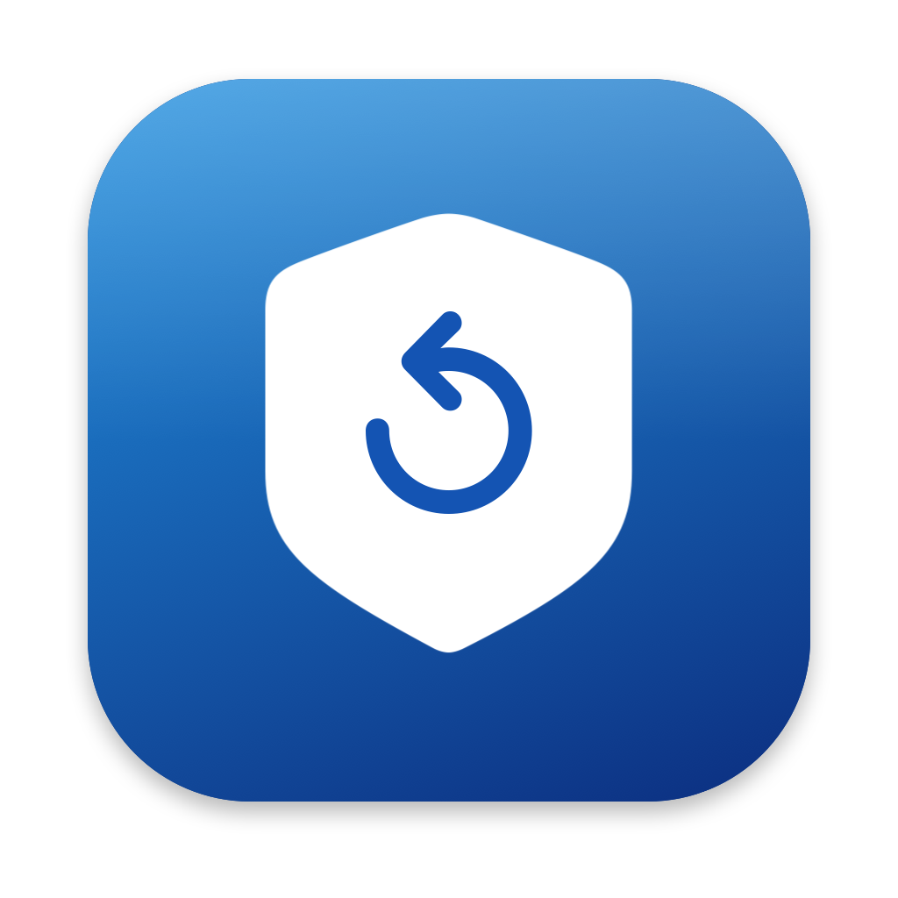
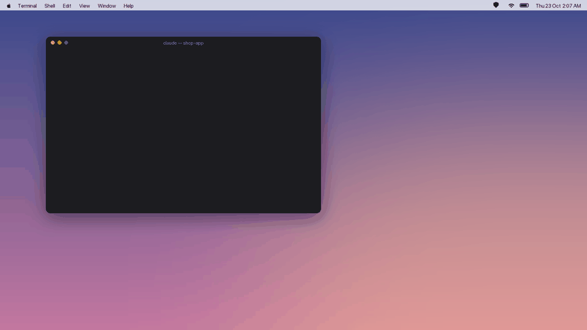
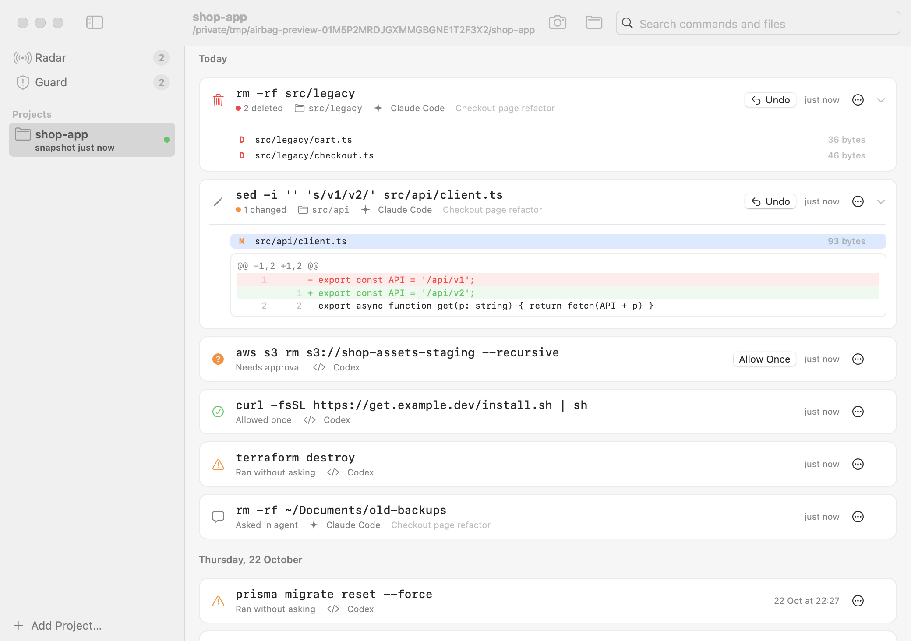
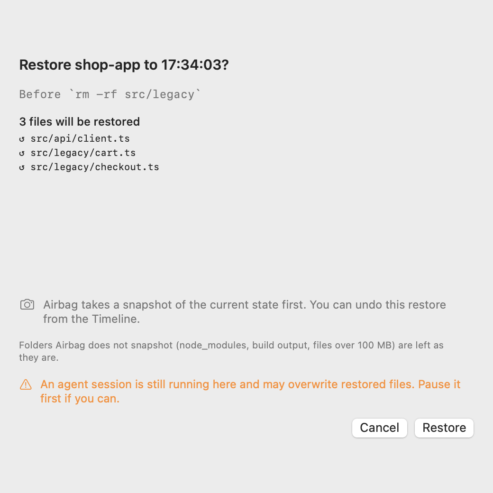
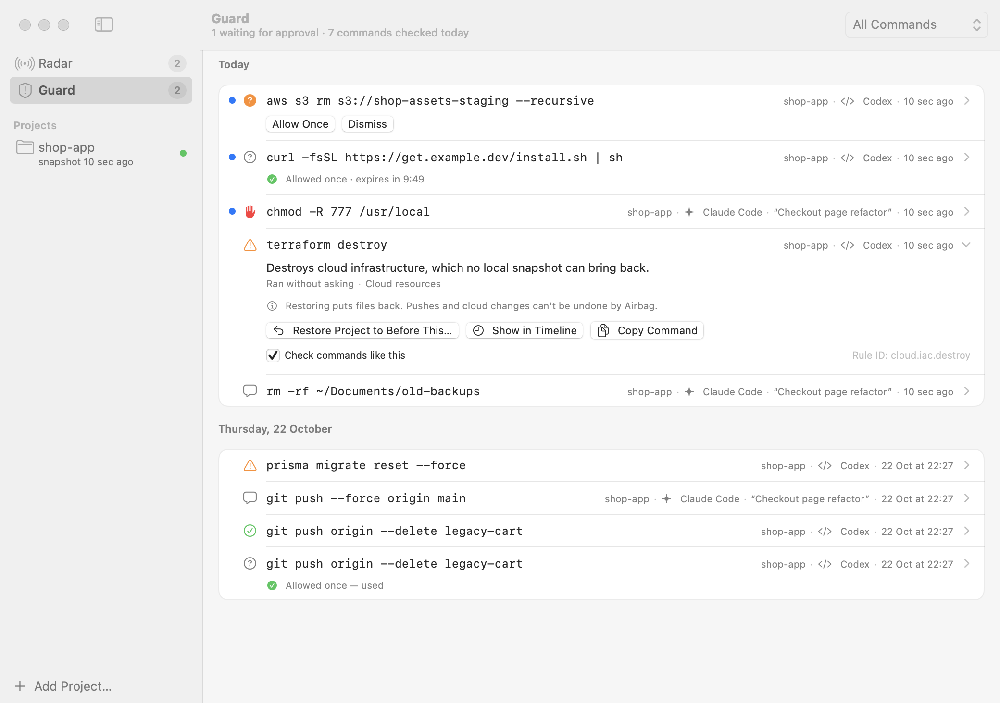
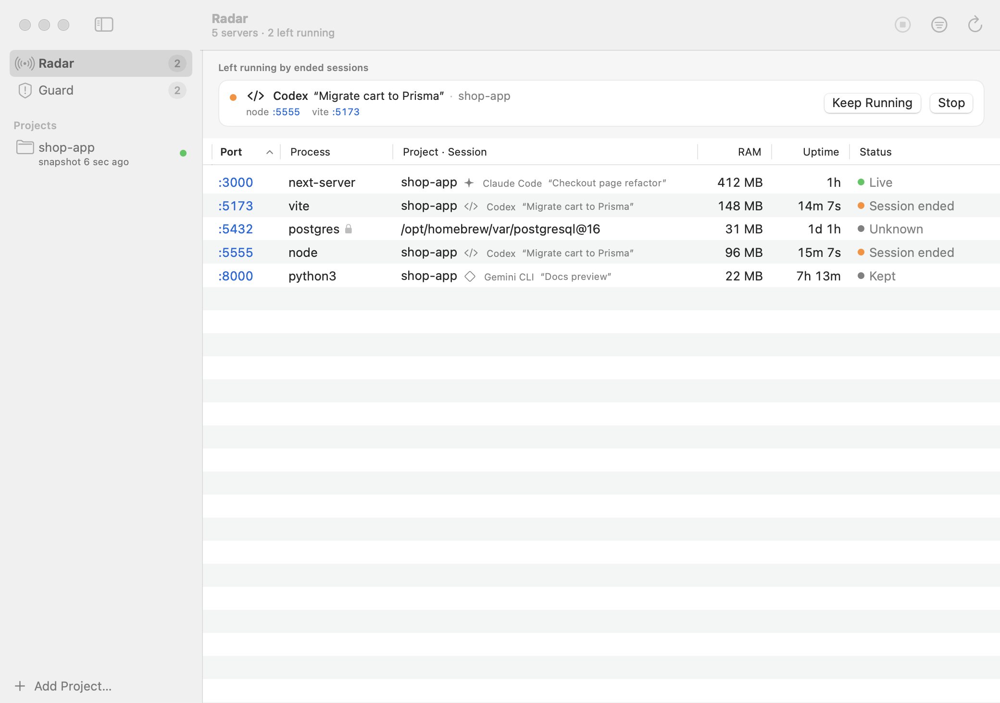
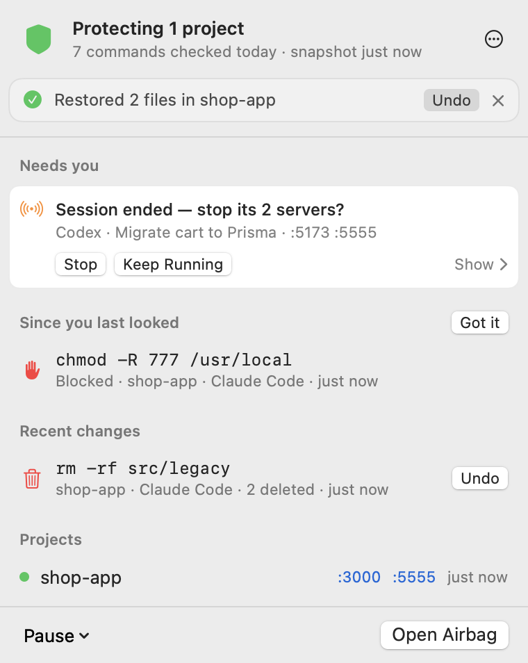
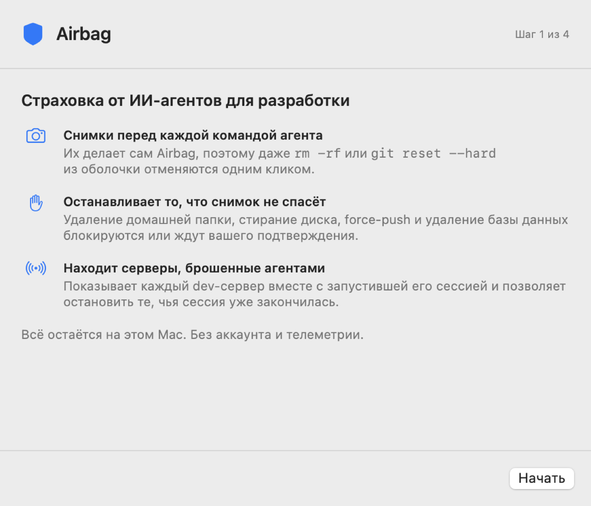

<p align="center">
  
</p>

<h1 align="center">Airbag</h1>

<p align="center">
  <b>Undo what your AI agent just did to your project.</b>
</p>

<p align="center">
  A free Mac menu bar app that snapshots your project before every command<br>
  Claude Code, Codex, Cursor, Gemini CLI or Copilot CLI runs,<br>
  so a deleted folder, a <code>git reset --hard</code> or a wiped <code>.env</code> is one click back.
</p>

<p align="center">
  <a href="https://github.com/a1murt/airbag/actions/workflows/ci.yml"></a>
  <a href="LICENSE"></a>
  
</p>

<p align="center">
  
  <br><sub><a href="docs/images/airbag-demo.mp4">▶ Watch in HD</a></sub>
</p>

<p align="center">
  <a href="https://github.com/a1murt/airbag/releases/latest"></a>
</p>

| 1. Your agent runs a command | 2. Airbag snapshots first | 3. You click Undo |
|---|---|---|
| `rm -rf src`, `git clean -fdx`, a "cleanup" script | In milliseconds, almost no disk, `.env` included | Right in the menu bar: what that command changed is back |

<p align="center">
  Free &amp; MIT · No account · No telemetry · No network · Interface in 19 languages<br>
  <a href="#install">Install</a> · <a href="#how-it-works">How it works</a> · <a href="#faq">FAQ</a> · <a href="docs/ARCHITECTURE.md">Docs</a> · <a href="SECURITY.md">Security</a>
</p>

---

## 2:07 a.m.

You left an agent on a long refactor and went to bed. Somewhere around step forty it decides to start clean:

```console
$ git clean -fdx && git reset --hard
```

Three hours of uncommitted work, gone. Your `.env` too, because git never tracked it. The agent's checkpoints cover
its own file edits, not what it runs in the shell, and Time Machine's last local snapshot is up to an hour old.

**With Airbag, that's one click.** A snapshot landed right before the command ran. Click the shield in the menu bar:
`git clean -fdx && git reset --hard` is at the top of *Recent changes*. Press **Undo**. Everything is back, `.env`
included, and the undo itself can be undone.

## Snapshot first, block last

Agents are good enough now that approving every command is the slowest part of the job. So we turn on bypass
permissions or `--yolo`, and hope.

The risk lives in the shell. Every agent ships its own undo, and each one stops at the edge of its own edits.
Blocklists help until the command hides inside a script. **A blocklist has to recognise the command. A snapshot
doesn't.**

So Airbag works the other way round. It sits underneath your agents, independent of them, and snapshots the project
before any command that can change files. Blocking is kept for the few commands no snapshot can undo.

I wanted one safety net under every agent I use, whichever one I open that day. That's what an airbag is for: not
to make you drive slower, but to let you drive. **Keep full-auto on.**

### What each safety net catches

| | **Airbag** | Agent checkpoints | git | Time Machine |
|---|:---:|:---:|:---:|:---:|
| Saves | before every command | per prompt | when you commit | about hourly |
| Shell commands (`rm`, `mv`, scripts) | ✓ | Claude Code: no¹ | if committed | last hourly snapshot |
| Uncommitted work | ✓ | own edits only | ✗ | last hourly snapshot |
| `.env` and git-ignored files | ✓ | own edits only | ✗ | last hourly snapshot |
| All your agents, one timeline | ✓ | one agent each | — | — |
| Blocks what nothing can undo | ✓ | ✗ | ✗ | ✗ |
| Dev servers agents left running | ✓ Radar | ✗ | ✗ | ✗ |

<sub>¹ Claude Code's <a href="https://code.claude.com/docs/en/checkpointing">checkpointing docs</a>: a file that only
Bash commands changed isn't tracked. Cursor's <a href="https://cursor.com/docs/agent/chat/checkpoints">checkpoints</a>
capture the files its agent modified. Time Machine keeps a
<a href="https://support.apple.com/en-us/102154">local snapshot about once an hour</a>.</sub>

## What you get

- **Keep full-auto on.** Airbag works in every permission mode, including bypass permissions and `--yolo`.
- **Undo** what the agent just did in one click from the menu bar, `.env` included. A file, a folder or a whole
  deleted project comes back too.
- **See** what every command changed: the timeline lists each command with what it deleted, changed and added.
- **Stop** the few commands no snapshot can undo, like `rm -rf ~` or wiping a disk, before they run.
- **Find** the dev server an agent left on `:3000`, and the session that started it.
- **Set it up in under a minute.** One timeline for Claude Code, Codex, Cursor, Gemini CLI and Copilot CLI.

### Timeline: every command, and what it changed

One row per agent command: `rm -rf src/legacy` · 2 deleted · Claude Code, grouped by day. **Undo** puts back exactly
what that command changed. Open a row for its files and diffs, or search a file name to find when it disappeared.

<picture>
  <source media="(prefers-color-scheme: dark)" srcset="docs/images/main-timeline-dark.png">
  
</picture>

### Undo and Restore: nothing is ever lost

**Undo** is instant, because it is reversible: Airbag snapshots before it too, and the message offers Undo again.
**Restore** takes a whole project (or one file) back to a chosen moment; it asks first and shows what comes back,
what gets reverted and what is set aside. A restore never deletes, and even a deleted project folder comes back.

<p align="center">
  <picture>
    <source media="(prefers-color-scheme: dark)" srcset="docs/images/restore-dark.png">
    
  </picture>
</p>

### Guard: stops what no snapshot can undo

Deleting your home folder or system folders, wiping a disk, deleting Airbag's own data: blocked before it runs, and
the agent is told to ask you instead of retrying. Agents can't approve their own commands.

Risky commands (force push, writes outside the project, databases, cloud resources, `curl | sh`, `sudo`) don't
interrupt the agent. They land in Guard with a dot on the menu bar icon, or go to the agent's own approval prompt
where it has one. Prefer to approve them first? One setting makes them wait for you, and a notification with
**Allow Once** tells you an agent is waiting.

<picture>
  <source media="(prefers-color-scheme: dark)" srcset="docs/images/main-guard-dark.png">
  
</picture>

### Radar: "Port 3000 is already in use", solved

Every listening dev server with its project, agent and session, even after the agent has exited. Servers left
running by an ended session come first, with **Stop** and **Keep Running** (also right in the notification). Stop
sends SIGTERM; force-stop is a separate click. Click a port to open it.

<picture>
  <source media="(prefers-color-scheme: dark)" srcset="docs/images/main-radar-dark.png">
  
</picture>

### Menu bar: everything at a glance

What just happened, with **Undo**. Anything that needs you. And proof it's working: "212 commands checked today".

<p align="center">
  <picture>
    <source media="(prefers-color-scheme: dark)" srcset="docs/images/popover-dark.png">
    
  </picture>
</p>

## Works with your agents

| Agent | Where |
|---|---|
| **Claude Code** | CLI · desktop · IDE |
| **OpenAI Codex** | CLI · app |
| **Cursor** | IDE · CLI |
| **Gemini CLI** | CLI |
| **GitHub Copilot CLI** | CLI |

Every agent gets a snapshot before each shell command that can change files, the same Guard, and session tracking,
in any permission mode. Protection doesn't depend on the app being open: the hook is a CLI.

## How it works

```text
agent ──hook──▶ airbag CLI ──▶ Guard: allow · risky · block
                    │
                    └──▶ snapshot (APFS clones, .env included) ──▶ the command runs

Airbag.app (menu bar): timeline · restore · Guard · Radar · snapshots after file changes
```

- **A hook, not a daemon.** Airbag adds its hook to each agent's *user* settings file, never to your project, keeps
  a backup, and removes exactly its own entries on uninstall.
- **APFS clones.** Unchanged files share storage, so a snapshot takes milliseconds and almost no extra disk.
  `node_modules`, build output and caches are skipped. Read-only commands need no snapshot.
- **The app** adds snapshots after file changes (FSEvents), the timeline, Guard and Radar.

### By the numbers

| | |
|---|---|
| Real agent shell commands replayed from the author's Mac | **1,987** |
| Ran silently (a snapshot first when they changed files) | **96 %** |
| Flagged as risky | **4.1 %** |
| Blocked | **1** |
| Hook overhead, median | **~13 ms** |
| Snapshot of an unchanged 5k-file project | **~10 ms** |
| Snapshot of an unchanged 50k-file project | **~120 ms** |
| Restoring 100 files | **~60 ms** |
| Idle app | **~0.3 % CPU, ~21 MB** |
| Guard test cases, including an adversarial red-team set | **444** |
| Automated tests, run in CI | **109** |

<sub>Deep dives: [architecture](docs/ARCHITECTURE.md) · [decisions](docs/DECISIONS.md) ·
[snapshot engine](docs/design/10-snapshot-engine.md) · [Guard rules](docs/design/12-circuit-breaker-rules.md) ·
[dogfooding](docs/research/09-dogfooding.md)</sub>

## Install

```bash
brew install --cask a1murt/airbag/airbag
```

Open Airbag from Applications: the welcome window connects your agents and picks your projects in under a minute.
Homebrew also puts the `airbag` command on your PATH, and `brew upgrade` keeps your agents connected.

<details>
<summary><b>Without Homebrew</b></summary>

**[Download the latest `.dmg`](https://github.com/a1murt/airbag/releases/latest)**, drag Airbag to Applications and
open it. macOS asks once on first launch: **System Settings → Privacy & Security → Open Anyway** (macOS 15 and later),
or right-click Airbag → **Open** (macOS 14).
</details>

<p align="center">
  <picture>
    <source media="(prefers-color-scheme: dark)" srcset="docs/images/welcome-dark.png">
    
  </picture>
</p>

### See it work in 60 seconds

Make a throwaway project with a secret in it:

```bash
mkdir -p ~/airbag-test/src && cd ~/airbag-test
echo "console.log('hi')" > src/app.js && echo "API_KEY=test" > .env
```

1. Menu bar → Airbag → ⋯ → **Add Project…** → `~/airbag-test`.
2. In that folder, ask your agent to run `rm -rf src .env`.
3. Menu bar → Airbag → **Undo** next to `rm -rf src .env`. Both are back, `.env` included.

### Build from source

Xcode Command Line Tools are enough:

```bash
git clone https://github.com/a1murt/airbag && cd airbag && make app   # → build/Airbag.app
```

## Command line

The CLI works without the app. Homebrew links it for you; with the DMG, put it on your PATH with:

```bash
echo 'alias airbag=/Applications/Airbag.app/Contents/Helpers/airbag' >> ~/.zshrc
```

```text
airbag snapshot                        take a snapshot now
airbag snapshots | log                 snapshots, and agent commands with the snapshot before each
airbag changes ID                      files changed by a snapshot
airbag diff FROM [TO] [--path F]       what changed (no TO = working tree)
airbag restore ID [--path P]           restore; never deletes, undoable
airbag check "<command>"               what Guard decides, and why (runs nothing)
airbag guard | allow ID                flagged commands; approve one once (you, not the agent)
airbag ports | stop PID [--force]      dev servers and the session that started them
airbag hooks status | install | uninstall [--all]
```

Ask Guard what it would do, without running anything:

```console
$ airbag check "rm -rf ~"
BLOCK  snapshot: recommended  (may change files: rm)
  [fs.rm.catastrophic] block: it would delete your home directory, which no snapshot covers.

agent sees: Airbag blocked `rm -rf ~`: it would delete your home directory, which no snapshot covers. Do not retry this command or work around it with another tool; choose a safer, narrower command or ask the user.

$ airbag check "git reset --hard"
ALLOW  snapshot: required  (may change files: git reset)
  [git.reset.hard] allow: it discards uncommitted changes (restorable from the snapshot taken first).
```

## Privacy

No account, no telemetry, no network. Search `Sources/` for `URLSession`: there's nothing to find.

- Everything stays on your Mac, in `~/Library/Application Support/Airbag`.
- Snapshots are copies of your project, `.env` included, and they never leave the machine.
- Airbag touches only its own hook entries in your agents' settings, and keeps a backup.

The threat model is in [SECURITY.md](SECURITY.md).

## FAQ

<details>
<summary><b>Will it slow my agent down or keep interrupting me?</b></summary>

No. The hook adds about 13 ms per command (median), a snapshot of an unchanged 5k-file project takes about 10 ms,
and read-only commands need no snapshot at all. Replaying 1,987 real agent shell commands, 96 % ran silently,
4.1 % were flagged as risky, and 1 was blocked.
</details>

<details>
<summary><b>Does it work with bypass permissions and <code>--yolo</code>?</b></summary>

Yes. That's what it's for. Snapshots, blocks and session tracking work in every permission mode, and every snapshot
carries its agent and session, so parallel sessions stay apart in one timeline.
</details>

<details>
<summary><b>My agent already has checkpoints. Why do I need this?</b></summary>

Checkpoints undo the agent's own file edits. Claude Code's docs say a file that only Bash commands changed isn't
tracked, and `rm`, `mv`, `git reset --hard` and cleanup scripts all run in the shell. Airbag snapshots before every
one of them, for all five agents in one timeline. Use both.
</details>

<details>
<summary><b>I commit often and have Time Machine. Isn't that enough?</b></summary>

git only brings back what you committed. It never saw your uncommitted changes or git-ignored files like `.env`.
Time Machine's local snapshots are hourly, so anything since the last one is gone. Airbag snapshots right before the
command that did the damage.
</details>

<details>
<summary><b>How is this different from a command blocker or a sandbox?</b></summary>

A blocker stops only the commands it recognises, and an agent can phrase a command differently or tuck it inside a
script. Airbag snapshots underneath, so even a script nobody parsed is undoable, and it blocks only the short list no
snapshot can cover. A sandbox limits what an agent can do; Airbag makes what it does reversible. They stack well.
</details>

<details>
<summary><b>What about databases, cloud resources and force pushes?</b></summary>

They live outside your project's files, so Airbag guards them at the command instead. Force pushes, database and
cloud-resource commands are flagged as risky and recorded in Guard, or go to the agent's own approval prompt. Change
one setting and they wait for you.
</details>

<details>
<summary><b>Can an agent switch Airbag off?</b></summary>

Deleting Airbag's data is blocked, touching its hooks is caught by Guard, and agents can't approve their own
commands: `airbag allow` works only for you.
</details>

<details>
<summary><b>Does the app have to be running?</b></summary>

No. The hook is a CLI, so snapshots before commands and blocks work with the app closed. The app adds snapshots
after file changes, plus the timeline, Guard and Radar.
</details>

<details>
<summary><b>How do I uninstall?</b></summary>

With Homebrew, `brew uninstall --cask airbag` removes Airbag's hooks from every agent too (`--zap` also deletes the
snapshots). Otherwise click **Disconnect** next to each agent in Airbag's Settings (⌘,), or run:

```bash
/Applications/Airbag.app/Contents/Helpers/airbag hooks uninstall --all
```

Then delete the app, and `~/Library/Application Support/Airbag` if you want the snapshots gone too. Airbag removes
exactly its own hook entries and nothing else.
</details>

## Contributing

Pull requests are welcome. The most useful ones:

- **Guard cases.** Found a command Airbag misjudges? Add it to
  [`rules.json`](Tests/AirbagCoreTests/Fixtures/rules.json), or to
  [`rules-redteam.json`](Tests/AirbagCoreTests/Fixtures/rules-redteam.json) for a bypass. Test with `airbag check`,
  never by running the command.
- **Translations.** The app speaks 19 languages; `make l10n` checks every one of them.
- **Bug reports** with the output of `airbag hooks status`.

```bash
make test   # Swift Testing suite
make e2e    # simulated agents against the real hook binary
make app    # build/Airbag.app
```

See [CONTRIBUTING.md](CONTRIBUTING.md), and report vulnerabilities privately as described in
[SECURITY.md](SECURITY.md).

---

<p align="center">
  <b>If Airbag ever hands you back an afternoon of work, star the repo.</b><br>
  It's how other people running agents find it.
</p>

## License

[MIT](LICENSE). Airbag is an independent project, not affiliated with Anthropic, OpenAI, Anysphere, Google or GitHub.
